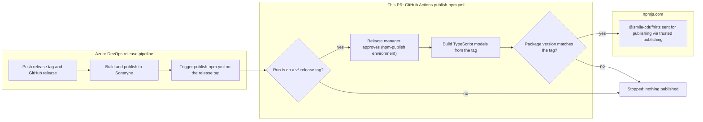

# Issue

**Title:** Publish @smile-cdr/fhirts to npm with trusted publishing

## Description

**Problem:** Currently, we deploy on Azure using a maven profile and a long-lived token. npm is [removing direct publishing with long-lived tokens](https://github.com/orgs/community/discussions/201329) (targeted for January 2027). Support for trusted publishing with Azure Pipelines is not supported. npm plans to support Stage-only OIDC for Azure and there is no timeline. 

**Changes:** This moves the `@smile-cdr/fhirts` publish into a GitHub Actions workflow that authenticates with [trusted publishing (OIDC)](https://docs.npmjs.com/trusted-publishers). The updated npm publishing workflow is shown in the diagram below:

### Config setup needed outside this PR - before merging

- create a GitHub `npm-publish` environment (tag rule `v*`, add required reviewers) to define who can approve a npm publish and when they are run
- optionally create a GitHub tag ruleset protecting `v* to ensure no one accidentally changes a tag during publish
- configure a trusted publisher for hapi fhir on npmjs
- add a step after the Sonatype stage on azure pipelines that triggers the GitHub workflow: `gh workflow run publish-npm.yml --repo hapifhir/hapi-fhir --ref v<version>`
- For backports, either: 
    - leave `DEPLOY_TYPESCRIPT_HINTS` in the azure mvn command until Jan 2027, to support older backports until then
    - release branches from `rel_8_12` onward need this change to publish to npm once tokens are disallowed.

Not yet run end to end: the first real test is the next release from a branch that has this change.

🤖 Generated with [Claude Code](https://claude.com/claude-code)

## Task

Modify the repository so that the issue described above is resolved. The repository is checked out at base commit `a16497859e51`. Edit files in place; the verifier captures your changes via `git diff` and scores them against an oracle patch using SWE-RL-style diff-similarity reward.