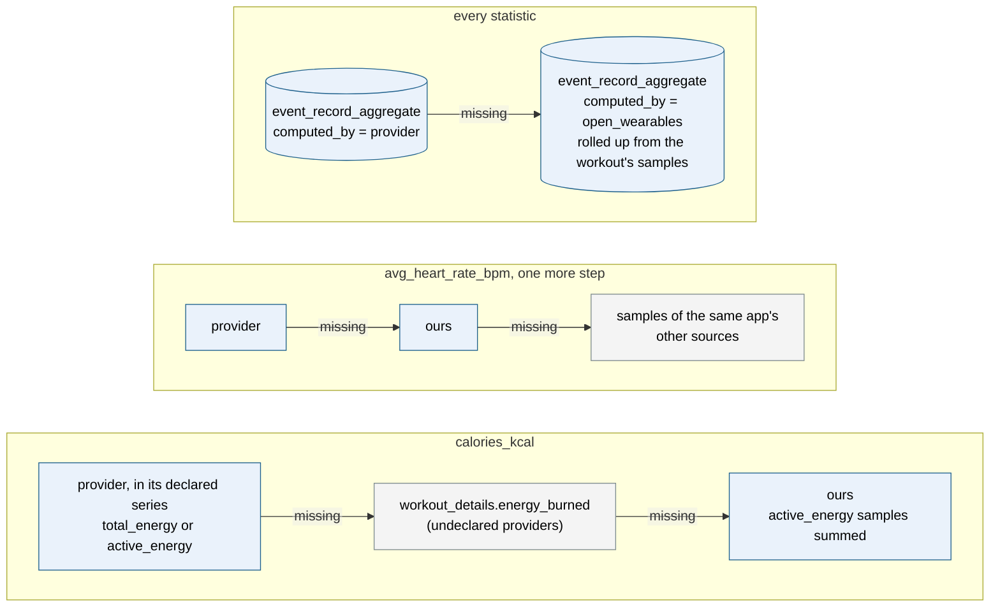

# Issue

**Title:** feat(api): aggregates: workout statistics

## Description

## ⚠️ Breaking change

Response shapes are unchanged; some values change.

| Field | Before | After |
|---|---|---|
| `/events/workouts` statistics a provider did not send | `null`, except `avg_heart_rate_bpm` | ours from the workout's own samples (heart rate min/max, steps, power, cadence, …) |
| `/events/workouts` `calories_kcal` without a provider figure | `null` | the workout's own active energy samples added up |
| `/events/workouts` `elevation_gain_meters`, `calories_kcal` when the provider sent `0` | `null` | `0.0` |
| `/events/workouts/totals`, `/summaries/activity` workout energy, distance, elevation | the provider's figures only | per workout the provider's, else ours |

## What does this change?

Workouts read their statistics from `event_record_aggregate`; `workout_details` keeps only what is not a series statistic, and `energy_burned` for providers whose energy series is not established yet.

| Field | Source (`event_record_repository.py:get_workout_statistics`, `workout_energy`) | Series | Statistic |
|---|---|---|---|
| `avg_heart_rate_bpm` | provider, else ours, else samples of the same app's other sources | `heart_rate` | `avg` |
| `max_heart_rate_bpm`, `heart_rate_min` | provider, else ours | `heart_rate` | `max`, `min` |
| `steps_count` | provider, else ours | `steps` | `sum` |
| `distance_meters`, `avg_pace_sec_per_km` | provider, else ours | `distance` | `sum` |
| `average_speed`, `max_speed` | provider, else ours | `speed` | `avg`, `max` |
| `average_watts`, `max_watts` | provider, else ours | `power` | `avg`, `max` |
| `average_cadence` | provider, else ours | `cadence` | `avg` |
| `elev_low`, `elev_high` | provider, else ours | `elevation` | `min`, `max` |
| `elevation_gain_meters` | provider, else ours | `elevation_gain` | `sum` |
| `calories_kcal` | provider in its declared series → `workout_details.energy_burned` → ours | `total_energy`, `active_energy` | `sum` |
| `/events/workouts/totals` energy, distance | the same, summed in SQL | | |
| `/summaries/activity` `elevation_meters` | provider, else ours | `elevation_gain` | `sum` |

The mapping is `WORKOUT_DETAIL_STATS`, the one the save path writes with, read the other way round.

Series webhooks gain `window_seconds` on every sample, as `/timeseries` did; the workout webhook keeps sending the values it was saved with.

## Why?

| Decision | Because |
|---|---|
| calories: declared series, then the column, then ours | a provider's own figure stays what clients saw; ours only fills workouts that had none |
| the column stays for undeclared energy | Oura, Polar, Suunto, Strava, Fitbit, SensorBio and Samsung workout energy has no established series yet (listed in the ingestion PR) |
| avg heart rate still falls back to the same app's other sources | our session row covers the workout's own source only |

<!-- This is an auto-generated comment: release notes by coderabbit.ai -->

<!-- coderabbit-ai-generated:v1 -->

## Summary by CodeRabbit

* **Improvements**
  * Workout responses now use aggregated statistics for distance, pace, heart rate, elevation, steps, speed, cadence, and power.
  * Calorie totals draw on available provider and workout data, while average heart rate is rounded consistently.
* **New Features**
  * Timeseries webhook samples now include `window_seconds`, showing the reporting-window duration or `null` for instant readings.
* **Documentation**
  * Webhook guidance explains `window_seconds` and provides examples for timed and instant readings.

<!-- end of auto-generated comment: release notes by coderabbit.ai -->

## Task

Modify the repository so that the issue described above is resolved. The repository is checked out at base commit `d96ad13fe996`. Edit files in place; the verifier captures your changes via `git diff` and scores them against an oracle patch using SWE-RL-style diff-similarity reward.