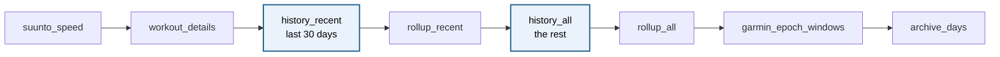
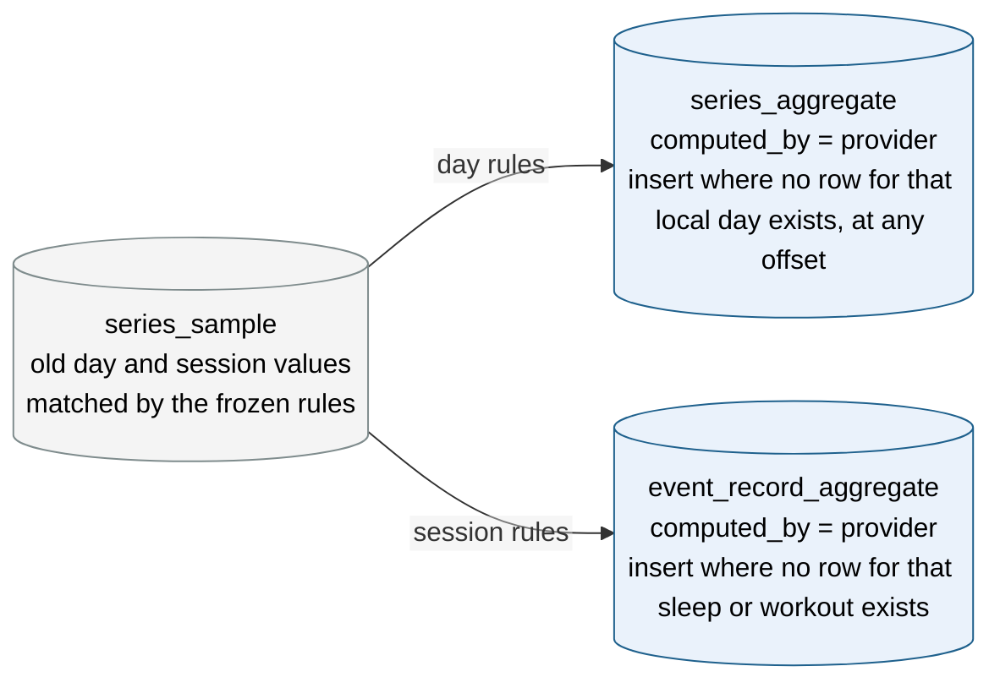
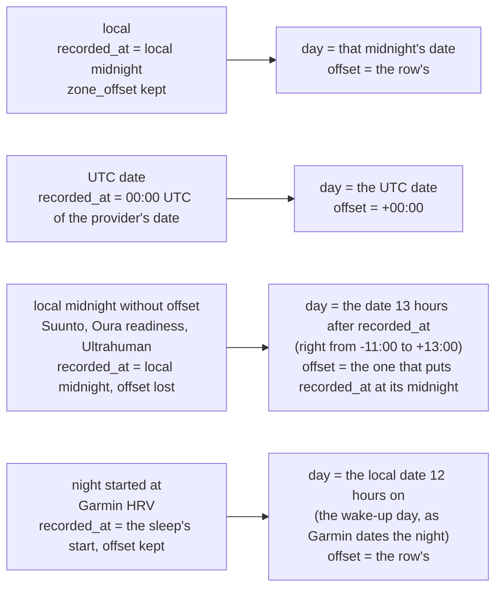

# Issue

**Title:** feat(backend): aggregates: backfill history

## Description

## What does this change?

Two more backfill steps copy the day and session values that code before the aggregate tables stored as samples.

A value lands only where the provider holds no row for that local day (at any offset) or that sleep or workout, so data written after the deploy wins. A day value stored more than once (a total re-sent as the day went on) is its latest.

The rules are frozen in `constants/series_types/history_rules.py`: they describe rows already written, so they do not follow a provider's mapping when it changes.

| Provider | Series | Rows | Becomes |
|---|---|---|---|
| Garmin | steps, active/basal energy, flights, distance, active and exercise time | `is_daily_total` | day, local midnight at the row's offset |
| Garmin | resting heart rate | all | day, local |
| Garmin | HRV rmssd | `external_id` without `:` (the night's average; readings carry `summaryId:offset`) | day, the night that started then: its wake-up date |
| Garmin | VO2 max, fitness age, skin temperature deviation | all | day, UTC date |
| Oura | steps, energy, distance, active and exercise time | all | day, local |
| Oura | skin temperature deviations, VO2 max | all | day, local midnight without offset |
| Oura | SpO2, breathing disturbance index, cardiovascular age | all | day, UTC date |
| Oura | respiratory rate, resting heart rate | all | session: the sleep holding `recorded_at` |
| Polar | daily activity | `is_daily_total` | day, UTC date (local wall clock stored as UTC) |
| Polar | HRV, respiratory rate, skin temperature (+ deviation) | at 00:00 UTC | day, UTC date |
| Withings | daily activity | `external_id LIKE 'activity:%'` | day, local |
| Withings | resting heart rate | all | session: the sleep holding it |
| Suunto | steps, active energy | `is_daily_total` | day, local midnight without offset |
| Suunto | resting HR, HRV, SpO2 (`max`) | `is_daily_total` | session: the sleep with its id, else ending then |
| Whoop | cycle total energy, steps | all | day, local |
| Whoop | recovery: resting HR, HRV, SpO2, skin temperature | all | session: the last main sleep ended within 24 h before |
| SensorBio | resting HR, HRV, SpO2 | at 00:00 UTC | day, UTC date |
| SensorBio | daily activity | all | day, UTC date |
| Ultrahuman | VO2 max, exercise time, resting HR, temperature deviation | all | day, local midnight without offset |
| Google Health | exercise time, derived basal energy | `is_daily_total` at 00:00 UTC | day, UTC date |
| Apple, Samsung, Health Connect | workout statistics (cadence, physical effort, running dynamics, stroke count, VO2 max, weather, steps) | at a workout's end, without `external_id` (a genuine record ending there, an Apple VO2 max estimate say, carries its own), never from the Apple Health XML export | session: every workout ending then |

How a stored `recorded_at` becomes a day:

| On a 25.6M-sample database | |
|---|---|
| daily totals to copy | Garmin 3,879, Oura 811, Whoop 155, Google 93, Ultrahuman 45, Polar 40 |
| SDK workout statistics at a workout's end | 10,578, found in 3.2 s |
| expected run | under a minute, a few minutes at 10× the size |

What cannot be recovered:

| | Why | Covered by |
|---|---|---|
| Garmin and Suunto daily totals overwritten by the epoch at the same local midnight | the samples' unique key dropped one of them | our rollup of that day's samples |
| SDK mean and max cadence | shared one row; read as the mean | - |
| Whoop recovery's sleep | its id was never stored; the last main sleep before it is a close guess | copied onto that sleep; #1941 moves the sample to the backup only where the sleep is found |
| Whoop cycles before 2026-09-30, Google rollUp before #1644 | stored at the cycle start / window start | lands on that day; the sample stays |

## What a client sees while it runs

The last 30 days of day and session values return first (seconds to minutes after the deploy), the rest after. Until then those days show our own rollup where it exists, else nothing; never a value twice.

## Why?

| Decision | Because |
|---|---|
| rules frozen, not read from the providers' mappings | they describe old rows; a later mapping change must not change what is copied or later deleted |
| last 30 days first | the days clients look at return before years of history |
| insert where missing | a value written after the deploy is newer than its history |
| the Apple Health XML export left out of the workout-end rule | it stores every sample without `external_id`, so a genuine record at a workout's end looks like a statistic |
| a workout's statistics joined on its end, not looked up per sample | no index leads with `end_datetime`: a lookup read every workout of the source for each sample (a source with 300k workouts: 300 s → 1.6 s) |
| copied a source's year at a time, a day value with the window that holds its day | a whole history in one statement grows without bound; by its day, a value re-sent through the day is never split between two windows, so the day's latest still wins |

## Task

Modify the repository so that the issue described above is resolved. The repository is checked out at base commit `8d8fe4b8f2fe`. Edit files in place; the verifier captures your changes via `git diff` and scores them against an oracle patch using SWE-RL-style diff-similarity reward.