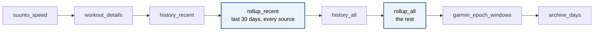
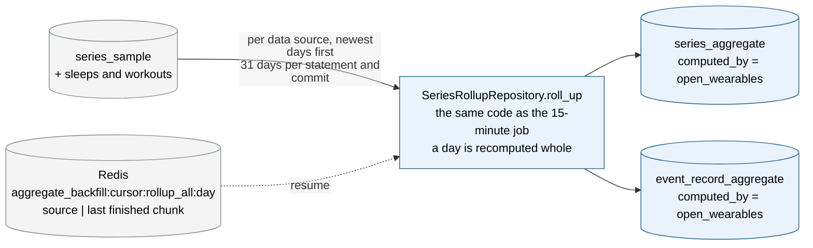

# Issue

**Title:** feat(backend): aggregates: backfill rollup

## Description

## What does this change?

Two backfill steps roll every data source's history up into our (`open_wearables`) day and session rows, as the 15-minute rollup does for new data.

**Off for now.** `ROLL_UP_HISTORY = False` in `aggregate_backfill_service.py` leaves both steps out; a release that sets it runs them where the other steps are long done, as the backfill counts a step by its own marker. Until then, and while `rollup_enabled` is off (the default), the activity and body summaries and the day, week and month timeseries count every day without a row from its samples, as before this stack; one rule (`days_from_samples`) stops them once the rollup is on and `rollup_all` is done.

| Measured on a 25.6M-sample database | |
|---|---|
| one month of the largest source (47k samples) | 0.1 s for its day statistics |
| whole history, all sources | ~1 minute of day statistics; with sessions and writes 2–5 minutes |
| a database 10× larger | 20–50 minutes, in runs of 240 s queued back to back |

## What a client sees while it runs

```mermaid
gantt
    title after the deploy, a 25.6M-sample database (minutes)
    dateFormat X
    axisFormat %M:%S
    tickInterval 1minute
    todayMarker off
    section provider rows
    history_recent, last 30 days   :done, 0, 30
    history_all, the rest          :done, 150, 210
    section our rows
    rollup_recent, last 30 days    :active, 30, 150
    rollup_all, the rest           :active, 210, 420
```

| Read | During the backfill | After |
|---|---|---|
| summaries, `1day` for the last 30 days | provider days from `history_recent` within seconds; ours (Apple, Health Connect, Samsung) after `rollup_recent`, minutes, once turned on; the summaries read the samples until then | complete |
| the same for older days | the provider's after `history_all`, ours after `rollup_all`, once turned on | complete |
| sleep physiology, workout statistics computed by us | as their days are rolled up | complete |
| anything written after the deploy | unaffected: the 15-minute rollup takes turns with the backfill, a chunk at a time | |

No value appears twice: readers take one row per day or session, the provider's before ours.

## Why?

| Decision | Because |
|---|---|
| the history's rollup off until a release turns it on | on a copy of production it took 31 minutes of database work; the summaries need it for no day, as they read the samples where a row is missing |
| a chunk holds the 15-minute rollup's lock, by token | both write our day rows: a run that read the samples first must not commit last; a holder whose lock expired must not release a newer one |
| each run first rolls up the days live writes queued | the 15-minute rollup tries once and would hardly ever find the lock free between two chunks |
| days retention emptied are only filled in, not recomputed | the same rule as the 15-minute rollup: a late sample alone must not replace a whole day |
| the last 30 days first, across every source | one heavy source must not hold back everyone's recent days |
| 31 days per statement | a month of 1 Hz data is a few million rows; a commit per month keeps transactions and lost work small |
| the same rollup code as the 15-minute job | history and new days are computed one way |
| every calendar day from a source's first sample, not a list of the days that have samples | listing them read the source's whole history up front (`DISTINCT` over every sample); an empty day costs an index probe |

## Task

Modify the repository so that the issue described above is resolved. The repository is checked out at base commit `0dfc1023c96d`. Edit files in place; the verifier captures your changes via `git diff` and scores them against an oracle patch using SWE-RL-style diff-similarity reward.