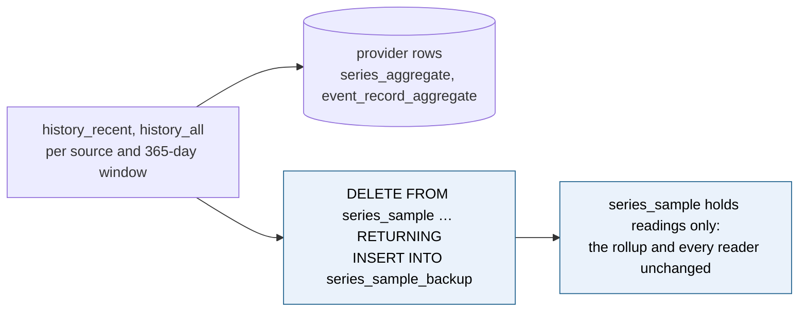

# Issue

**Title:** feat(backend): aggregates: move the copied history values to series_sample_backup

## Description

## ⚠️ Breaking change

| Who | Change |
|---|---|
| `/timeseries?resolution=raw` and the bucketed resolutions, readers of past day values | the history's day and session values (Garmin daily steps, Oura readiness temperatures, SDK workout statistics, …) leave the samples, as new ones already did; they are in `resolution=1day` and on the sleeps and workouts |
| `summaries/data`, its timeline | those values are no longer counted as samples |
| SQL, reports, BI reading `series_sample` | the moved rows are in `series_sample_backup`, same columns and ids |

No sample is deleted: they move to `series_sample_backup`, and the downgrade moves them back.

## What does this change?

`series_sample_backup` has the columns of `series_sample` and one index, `(data_source_id, series_type_definition_id, recorded_at)`, which the data source's cascade and a restore use. The history steps move what they copied into the provider's aggregate rows there, by the same frozen rules, in the same window and transaction as the copy.

| Rule | Moved |
|---|---|
| day rules (Garmin, Oura, Polar, Suunto, Withings, Whoop, SensorBio, Ultrahuman, Google) | every matching sample of the window's days, at any instant: Garmin's nightly HRV at the sleep's start and its noon user metrics too |
| session rules (Oura, Withings, Suunto, Whoop night values) | a matching sample its sleep holds; one without stays a reading, as the copy left it |
| SDK workout statistics | a matching sample at a workout's end (joined on it, not looked up per sample), never from the Apple Health XML export |

Once the history's rollup runs, our day and session rows come out as on an instance that never stored day values as samples: `physical_effort` at `resolution=1day`, for example, no longer shows days built from SDK workout statistics. Dropping the history later is `DROP TABLE series_sample_backup`.

## Why?

| Decision | Because |
|---|---|
| moved, not deleted | deleting is irreversible and the step would not run again; a downgrade after it lost the history |
| a table, not a column marking the rows | a column outside the `(source, type, time)` index turned every sample count from an index-only scan into a read of the table: `summaries/data` went from 1 s to 42 s on a copy of production. With the rows gone from `series_sample`, no reader needs a condition |
| moved by the history step, in its window | bounded like the copy, one statement per rule; a day value is moved only by the window that copies its day, as the copy reads two days past the window's edges |
| moved after every copy of the window | a sample two rules match is still there for the second |
| retention leaves the backup alone | it holds a fixed set: no row is added once the backfill is done |

## Task

Modify the repository so that the issue described above is resolved. The repository is checked out at base commit `00b891fbbb0f`. Edit files in place; the verifier captures your changes via `git diff` and scores them against an oracle patch using SWE-RL-style diff-similarity reward.